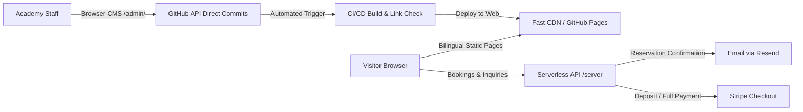

<div align="center">

# 🏄‍♂️ MUNDAKA SURF ACADEMY
### Official Bilingual Web Platform & Booking Engine

<p align="center">
  <strong>Erreka 6, 48360 Mundaka, Bizkaia (Basque Country, Spain)</strong><br>
  <em>Founded by professional surfer Xabier Gondra León</em>
</p>

[](https://nodejs.org/)
[](#architecture)
[](#localization)
[](LICENSE)
[](#deployment)

---

[🌐 Live Site](https://sharabumanojkumar.github.io/Mundaka-surf-Academy/) • [📖 Documentation](docs/BRIEF.md) • [🛠️ Admin Panel](https://sharabumanojkumar.github.io/Mundaka-surf-Academy/admin/) • [📡 API Reference](docs/api.md)

</div>

<br>

## 🌊 Overview

**Mundaka Surf Academy** is a high-performance, bilingual (Spanish-first with English under `/en/`) digital platform engineered with **zero external runtime framework dependencies**. Delivering near-instant initial paint times and smooth scroll performance, it integrates interactive booking flows, dynamic tide-based scheduling, an in-browser GitHub-backed CMS admin panel, and prepared serverless payment microservices.



---

## ✨ Key Capabilities

| Feature | Description |
| :--- | :--- |
| **🚀 Zero-Dependency Engine** | Pure native Node.js static site generator compiling modular HTML partials and CSS design tokens in milliseconds. |
| **🌍 First-Class Bilingualism** | Full Spanish (canonical) and English (`/en/`) coverage, synchronized via shared schema locale dictionaries. |
| **📅 Tide & Season Scheduling** | Custom booking calendar mapping daily lesson windows to Mundaka's world-famous estuary tides. |
| **💳 Flexible Payment Architecture** | Ready for both booking requests and instant Stripe deposits (15% / 100%) with automated webhook handling. |
| **⚡ Headless Browser CMS** | Secure GitHub API-driven `/admin/` portal allowing staff to manage pricing, instructors, reviews, and photos without database infrastructure. |
| **🎨 4K Enhanced Imagery** | Self-hosted WebP responsive image sets with portrait mobile crops and smooth hardware-accelerated video clips. |

---

## 🛠️ CLI Quickstart

The project requires **Node.js 18 or higher** with no `npm install` needed.

```bash
# 1. Clone repository
git clone https://github.com/SHARABUMANOJKUMAR/Mundaka-surf-Academy.git
cd Mundaka-surf-Academy

# 2. Start local development server (with hot reload)
npm run dev

# 3. Build production distribution
npm run build

# 4. Run automated unit tests & link validation
npm test
```

### Script Reference

| Command | Action | Output / Target |
| :--- | :--- | :--- |
| `npm run dev` | Launches local server with live-reload watching `src/`, `public/`, and config | `http://localhost:4321` |
| `npm run build` | Compiles 17 pages across all locales with minified CSS and image manifests | `dist/` |
| `npm run check` | Strict validation of every internal link, anchor tag, image, and asset | Terminal report |
| `npm run preview` | Serves existing `dist/` build without hot-watching | `http://localhost:4321` |
| `npm test` | Runs server mock tests, CMS helper tests, and complete build verification | Full CI Test Suite |

---

## 📂 Project Structure

```
mundaka-surf-academy/
├── .github/workflows/         # Automated GitHub Actions Pages deployment
├── brand/                     # Original master logos and reference imagery
├── docs/                      # Architectural briefs, API docs, and checklists
│   ├── BRIEF.md               # Client specification breakdown
│   ├── DOMAIN-AND-PAYMENTS.md # Production Stripe and domain setup
│   └── api.md                 # Serverless endpoints documentation
├── public/                    # Static assets copied directly to dist/
│   ├── admin/                 # Browser-only GitHub CMS interface
│   ├── assets/                # WebP images, SVGs, WOFF2 fonts, video
│   └── data/                  # Live runtime JSON (plans, team, gallery, schedule)
├── scripts/                   # Core tooling
│   ├── build.mjs              # Custom HTML/CSS compiler and template parser
│   └── serve.mjs              # Zero-dependency local dev server
├── server/                    # Modular serverless Request/Response handlers
│   ├── enquiry.mjs            # Email & booking reservation API
│   ├── create-checkout-session.mjs # Stripe session calculation
│   └── stripe-webhook.mjs     # Webhook verification
├── src/                       # Source templates and design system
│   ├── locales/               # es.json and en.json translation mappings
│   ├── pages/                 # Individual page templates
│   ├── partials/              # Reusable components (header, footer, maps, icons)
│   ├── scripts/               # Client-side modules (booking, calendar, motion)
│   └── styles/                # Modular CSS with design token variables
└── site.config.json           # Global site metadata, contacts, and feature flags
```

---

## 🎨 Brand & Design Tokens

Sampled directly from the official Mundaka crest and marine surroundings:

| Token Name | Hex Code | Visual Swatch | Primary Role |
| :--- | :--- | :---: | :--- |
| `--color-teal-deep` | `#004A5C` |  | Primary headings, headers, deep text |
| `--color-teal-badge` | `#006C88` |  | Brand accent, badges, buttons |
| `--color-turquoise` | `#30CBC6` |  | Vibrant highlights, fills, active states |
| `--color-aqua` | `#A0F5EE` |  | Light tint surfaces, water overlays |
| `--color-sand` | `#F8F9FA` |  | Warm card backgrounds and alternate sections |

- **Headings Font**: `Montserrat` (matches historic Mundaka surf typography)
- **Body Font**: `Inter` (optimized for readability across mobile screens)

---

## 🔒 Browser CMS (`/admin/`)

The administration suite runs entirely client-side under `/admin/`:
- **Direct GitHub Sync**: Commits edits directly to the `main` branch via GitHub REST API without requiring a database or third-party CMS service.
- **Auto Re-deploy**: Every saved modification triggers `.github/workflows/pages.yml` to re-compile and publish in ~60 seconds.
- **Client-Side Optimization**: Photos uploaded in admin are automatically resized and converted to optimized WebP formats (480px, 800px, 1200px, 1600px) directly in the browser before being committed.

---

## 💳 Payments & Booking System

The platform supports a dual-mode lifecycle configured in `site.config.json`:

1. **Request Mode (Default)**:
   - Form delivers inquiries directly to the academy via email/webhook without collecting online payment.
2. **Online Deposit Mode**:
   - Enable via `site.config.json -> payments.enabled: true`.
   - Direct integration with Stripe Checkout allowing surfers to reserve with a **15% deposit** or pay **100% upfront**.
   - Price calculation is strictly validated server-side against [public/data/plans.json](public/data/plans.json).

---

## 🚀 Deployment

Every push to `main` automatically triggers the GitHub Actions workflow at [.github/workflows/pages.yml](.github/workflows/pages.yml):
1. Sets up Node.js 22.
2. Compiles static distribution (`node scripts/build.mjs --check`).
3. Deploys `dist/` directly to **GitHub Pages**.

---

<div align="center">

**Mundaka Surf Academy © 2026** • Crafted with precision for the Basque Country surf community.

</div>
